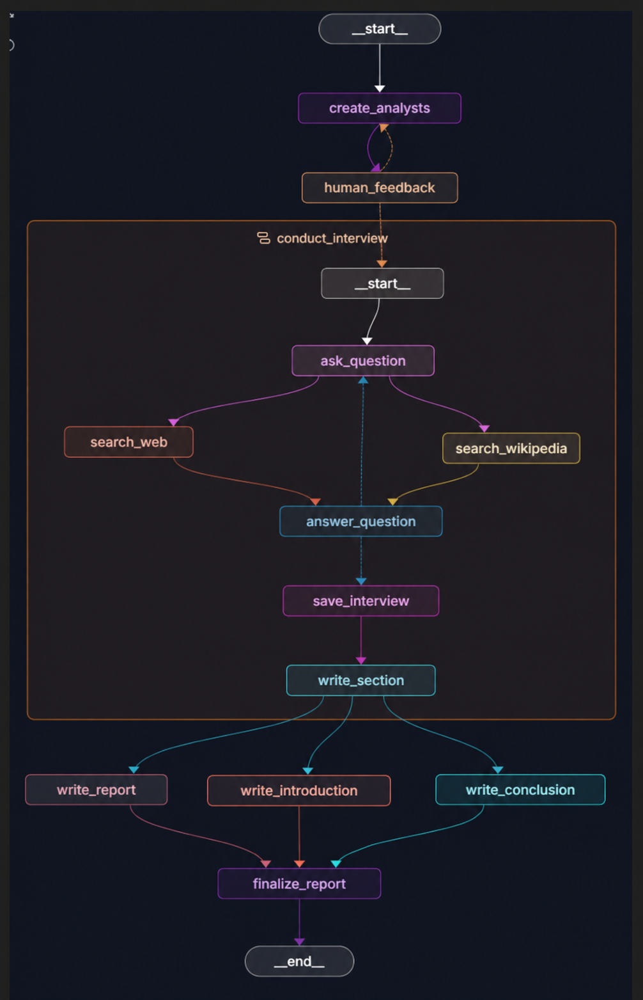

# LangGraph Research Assistant

> A multi-agent research workflow that creates analyst personas, runs parallel interview loops grounded in web and Wikipedia search, and synthesizes the results into a cited Markdown report using LangGraph, LangChain, Groq, and Tavily.

[](https://www.python.org/)
[](https://www.langchain.com/langgraph)
[](https://www.langchain.com/)
[](https://console.groq.com/)
[](https://www.tavily.com/)
[](https://docs.astral.sh/uv/)

---

## What Is This?

Given a research topic, this LangGraph app generates a panel of analyst personas, lets you approve or revise them, and then sends each analyst through an interview with an "expert" whose answers are grounded in Tavily web search and Wikipedia. Each interview becomes a report section, and the sections are combined into a final Markdown report with an introduction, conclusion, and sources.

The project demonstrates several practical agent patterns:

- Human-in-the-loop review using LangGraph `interrupt`.
- Structured analyst generation with Pydantic models.
- Parallel interview fan-out using LangGraph's `Send` API.
- Parallel retrieval from two sources (Tavily + Wikipedia) inside each interview turn.
- Map-reduce report writing: sections are written per analyst, then reduced into one report.
- Client-side rate limiting and retries to stay within free-tier API limits.

| File | Responsibility |
|---|---|
| `src/agent.py` | Full research graph: analysts → feedback → interviews → report |
| `src/creating_analysts.py` | Standalone graph for generating and reviewing analysts |
| `src/answering_questions.py` | Interview subgraph: question, search, answer, section writing |
| `src/utils/nodes.py` | Node implementations for analysts, interviews, search, and report writing |
| `src/utils/edges.py` | Conditional routing and the interview fan-out |
| `src/utils/states.py` | State definitions for the three graphs |
| `src/utils/objects.py` | Pydantic models for analysts and structured outputs |
| `src/utils/prompts.py` | Prompt templates |
| `src/utils/models.py` | Groq chat model setup with rate limiting and retries |
| `langgraph.json` | LangGraph CLI / Studio graph registration |

---

## Screenshot

### Full Research Graph



The full graph creates analyst personas, pauses for human feedback, runs one interview subgraph per analyst, writes a section from each, and then produces the introduction, report body, and conclusion in parallel before assembling the final report.

> The screenshot was taken before the second search node was switched to Wikipedia, so it still shows `search_web2` where the graph now has `search_wikipedia`.

---

## Feature List

### Analyst Generation

- Generates a configurable number of analyst personas for a topic.
- Uses structured output through the `Perspectives` and `Analyst` Pydantic models.
- Pauses with an `interrupt` so you can approve the analysts or give feedback to regenerate them.
- Blank input, `ok`, `okay`, `perfect`, `continue`, or `next` approves the analysts; anything else is treated as feedback.

### Interview Workflow

- Each analyst starts from a topic-aware opening message.
- Every turn, the analyst asks a question, both search nodes retrieve context in parallel, and the expert answers using only that context, with citations.
- Each speaker sees the conversation from its own side (its own turns as AI messages, the other side's as user messages), which keeps requests valid for models that don't allow assistant-message prefilling.
- The interview ends after `max_num_turns` expert answers (default 2) or when the analyst closes with "Thank you so much for your help!".
- The transcript and sources are turned into a short report section.

### Web Research

- **Tavily**: top 2 web results, each trimmed to 600 characters.
- **Wikipedia**: top page, trimmed to 1,500 characters.
- Search queries are generated from the conversation, not hard-coded.
- A failed search is logged and skipped instead of crashing the run.
- The expert only receives the current turn's search results, so prompts don't grow with every turn.

### Report Synthesis

- Analyst sections are consolidated into a single report body.
- Introduction and conclusion are written by separate nodes in parallel.
- The final report combines introduction, body, conclusion, and a deduplicated sources list.

---

## How It Works

1. **You provide a topic** and the maximum number of analysts.
2. **Analysts are generated.** `create_analysts` asks the model for structured analyst personas.
3. **You review them.** `human_feedback` interrupts the graph. Approve to continue, or send feedback to regenerate.
4. **Interviews run in parallel.** `initiate_all_interviews` uses `Send` to start one interview subgraph per analyst.
5. **Each turn is search-grounded.** The analyst's question is turned into a search query, and Tavily and Wikipedia are queried in parallel.
6. **The expert answers** using only the retrieved context, with numbered citations.
7. **Sections are written.** Each finished interview becomes a section, which is passed back to the parent graph through the shared `sections` key.
8. **The report is assembled.** `write_report`, `write_introduction`, and `write_conclusion` run in parallel, then `finalize_report` combines them into `final_report`.

---

## Architecture

```text
Research topic
    -> create_analysts
    -> human_feedback
        -> feedback given: back to create_analysts
        -> approved: fan out one interview per analyst (Send API)
    -> conduct_interview  (subgraph, one per analyst)
        -> ask_question
        -> search_web + search_wikipedia   (parallel)
        -> answer_question
        -> repeat until max turns or the analyst ends the interview
        -> save_interview
        -> write_section   -> sections
    -> write_report + write_introduction + write_conclusion   (parallel)
    -> finalize_report
    -> final_report (Markdown)
```

Graphs registered in `langgraph.json`:

| Graph | Entry Point | Purpose |
|---|---|---|
| `agent` | `src/agent.py:graph` | Full research and reporting workflow |
| `create_analysts` | `src/creating_analysts.py:graph` | Generate and review analyst personas only |
| `asnwer_question` | `src/answering_questions.py:question_answer_graph` | Run a single interview |

---

## Project Structure

```text
research_agent/
|
+-- main.py
+-- langgraph.json
+-- pyproject.toml
+-- uv.lock
+-- README.md
+-- img/
|   `-- Screenshot 2026-10-10 101749.png
+-- src/
|   +-- __init__.py
|   +-- agent.py
|   +-- answering_questions.py
|   +-- creating_analysts.py
|   `-- utils/
|       +-- __init__.py
|       +-- edges.py
|       +-- models.py
|       +-- nodes.py
|       +-- objects.py
|       +-- prompts.py
|       `-- states.py
`-- .env              (not committed)
```

---

## Getting Started

### Prerequisites

| Requirement | Notes |
|---|---|
| Python 3.12+ | Required by `pyproject.toml` |
| `uv` | Dependency installation and command execution |
| Groq API key | For the `openai/gpt-oss-20b` model |
| Tavily API key | For web search |

Wikipedia search needs no API key.

If `uv` is not installed:

```bash
pip install uv
```

### 1. Clone the repository

```bash
git clone https://github.com/<your-username>/research_agent.git
cd research_agent
```

### 2. Install dependencies

```bash
uv sync
```

### 3. Configure environment variables

Create a `.env` file in the project root:

```env
GROQ_API_KEY=your_groq_api_key_here
TAVILY_API_KEY=your_tavily_api_key_here

# Optional: tracing in LangSmith
LANGSMITH_API_KEY=your_langsmith_api_key_here
LANGSMITH_PROJECT=research_agent
```

### 4. Run with LangGraph Studio

```bash
uv run langgraph dev
```

Open the Studio URL shown in the terminal and pick the `agent` graph.

---

## Example Input

Start the `agent` graph with:

```json
{
  "topic": "The business impact of retrieval-augmented generation in enterprise support teams",
  "max_analysts": 2
}
```

The graph pauses at `human_feedback` and shows the generated analysts. Resume with `ok` to continue, or with feedback such as `add an analyst focused on cost` to regenerate them.

When the run finishes, the `final_report` field contains the Markdown report.

---

## Environment Variables

| Variable | Required | Purpose |
|---|---:|---|
| `GROQ_API_KEY` | Yes | Authenticates the Groq chat model |
| `TAVILY_API_KEY` | Yes | Authenticates Tavily web search |
| `LANGSMITH_API_KEY` | No | Enables LangSmith tracing |
| `LANGSMITH_PROJECT` | No | LangSmith project name for traces |

---

## Rate Limits and Run Time

Groq's free tier limits `openai/gpt-oss-20b` to 8,000 tokens per minute across all requests. A full run with 2 analysts makes roughly 20 model calls, so the app is configured to stay under that limit. All of these settings are in `src/utils/models.py`:

| Setting | Value | Why |
|---|---|---|
| `InMemoryRateLimiter` | ~5 requests/min, no bursts | Shared by every node, including the parallel interviews |
| `max_retries` | 5 | Waits and retries after a 429 instead of failing |
| `max_tokens` | 1024 | Limits the output tokens reserved per request |
| `reasoning_effort` | `low` | gpt-oss is a reasoning model; less reasoning uses fewer tokens |

Together with the trimmed search results, a 2-analyst run takes about **4–6 minutes**. If your plan has higher limits, raise `requests_per_second` to make runs faster.

To use a different model, edit `llm` in `src/utils/models.py`. `langchain-google-genai` is also installed if you want to switch to Gemini; set `GOOGLE_API_KEY` and adjust the rate limiter to that model's limits.

---

## Key Design Decisions

| Choice | Reason |
|---|---|
| LangGraph state machines | Makes the workflow explicit, inspectable, and easy to debug in Studio |
| Human feedback interrupt | Lets you fix the analyst panel before spending API calls on research |
| Structured analyst objects | Keeps persona generation predictable and type-safe |
| Interview subgraph | Encapsulates the repeated question → search → answer loop |
| Two retrieval sources | Tavily gives current web results; Wikipedia gives stable background |
| Speaker-relative message view | Each LLM call ends with a user message, as chat models expect |
| Shared rate limiter | One limiter covers all parallel calls, so the fan-out can't burst past API limits |

---

## Tech Stack

| Layer | Tool | Role |
|---|---|---|
| Language | Python 3.12+ | Runtime |
| Orchestration | LangGraph | State graphs, interrupts, fan-out |
| LLM framework | LangChain | Messages, structured output, rate limiting |
| LLM provider | Groq (`openai/gpt-oss-20b`) | Analysts, interviews, report writing |
| Web search | Tavily | Current web results |
| Encyclopedia search | Wikipedia (`WikipediaLoader`) | Background context |
| Configuration | python-dotenv | Loads `.env` |
| Package management | uv | Dependencies and running commands |

---

## Limitations

- Free-tier rate limits make full runs slow (several minutes).
- Search results are trimmed to save tokens, so answers are based on short excerpts.
- Report quality depends on the topic and on what Tavily and Wikipedia return.
- `main.py` is a placeholder; the workflow currently runs through LangGraph Studio only.
- There are no automated tests yet.
- Generated reports are drafts and should be checked before use in business, academic, legal, medical, or financial decisions.

---

## Future Improvements

- Generate the search query once per turn and share it between both search nodes (saves one call per turn).
- Add a CLI runner that saves the report to a Markdown file.
- Add tests for graph routing, section passing, and report assembly using a fake LLM.
- Make the model and rate limits configurable through environment variables.
- Add a Streamlit or FastAPI interface.

---

## Security Notes

- Never commit `.env` or real API keys.
- Rotate keys immediately if they are pushed to a public repository.

---

## License

MIT.
